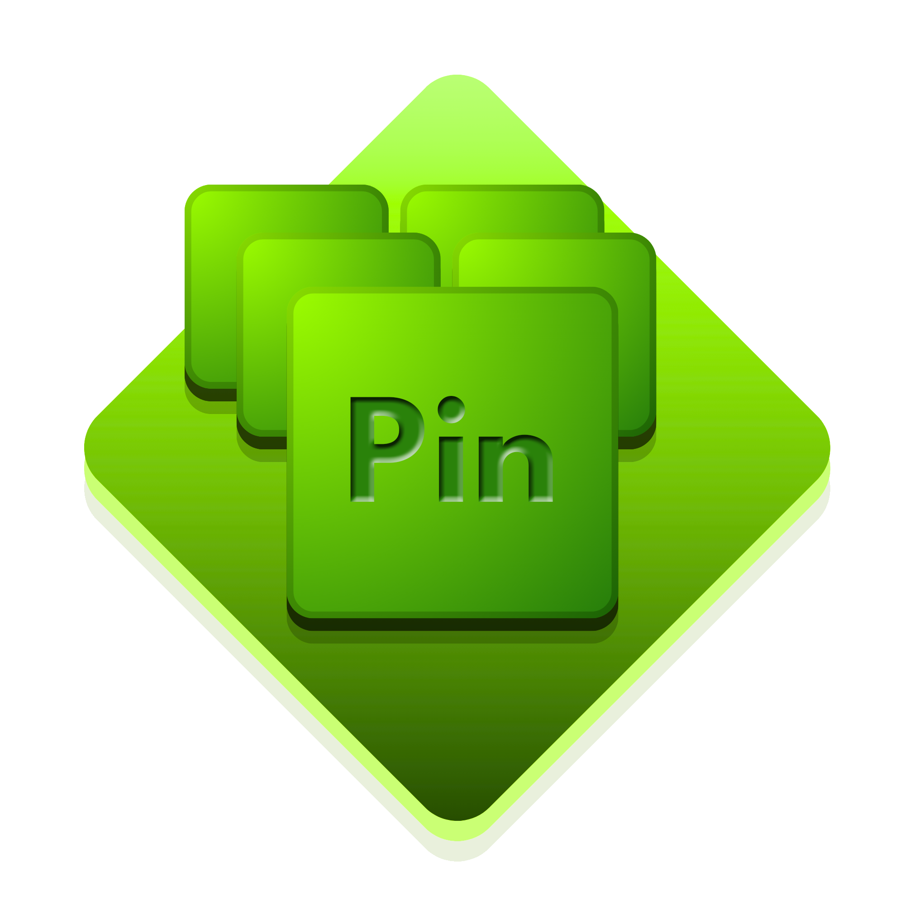

# Iron Pins
Iron Pins est à l'origine un exercice de formation Développement IA par Simplon.
Conçu en JavaScript, HTML5 et CSS, on utilisera l'outil Tauri pour l'intégrer comme programme.
Iron Pins est un gestionnaire de tâches simple et intuitif.
Son design moderne se veut simple et personnalisable.

# Fonctionnalités
## Gestion des tâches
L'utilisateur peut créer des "Pins" avec une couleur de fond au choix, avec un statut, un titre et une description. Ces Pins réprésente une tâche.
Les pins s'affichent successivement les uns après les autres et leur contenu est modifiable. Dans ceux-ci, on affiche une pastille de couleur représentant le statut du pin.
Bleu: À faire, Jaune: En cours, Vert: Terminé et Rouge: Bloqué.

## Gestion des tableaux
Dans Iron Pins, les pins sont stockés dans un tableau. Ce tableau permet à l'utilisateur de séparer les pins pour d'autres projets.

## Stockage Local
Dans sa particularité d'utiliser JavaScript, Iron Pins stocke directement les données dans le stockage local de JavaScript. Cela signifie qu'à la base, Pins n'a pas besoin d'enregistrer dans un fichier, excepté en cas d'un transfert. (À venir)

## Fonctionnalités à venir
- Export et Importation d'un tableau depuis un fichier
- Affichage de la date de création
- Choisir une couleur personnalisée