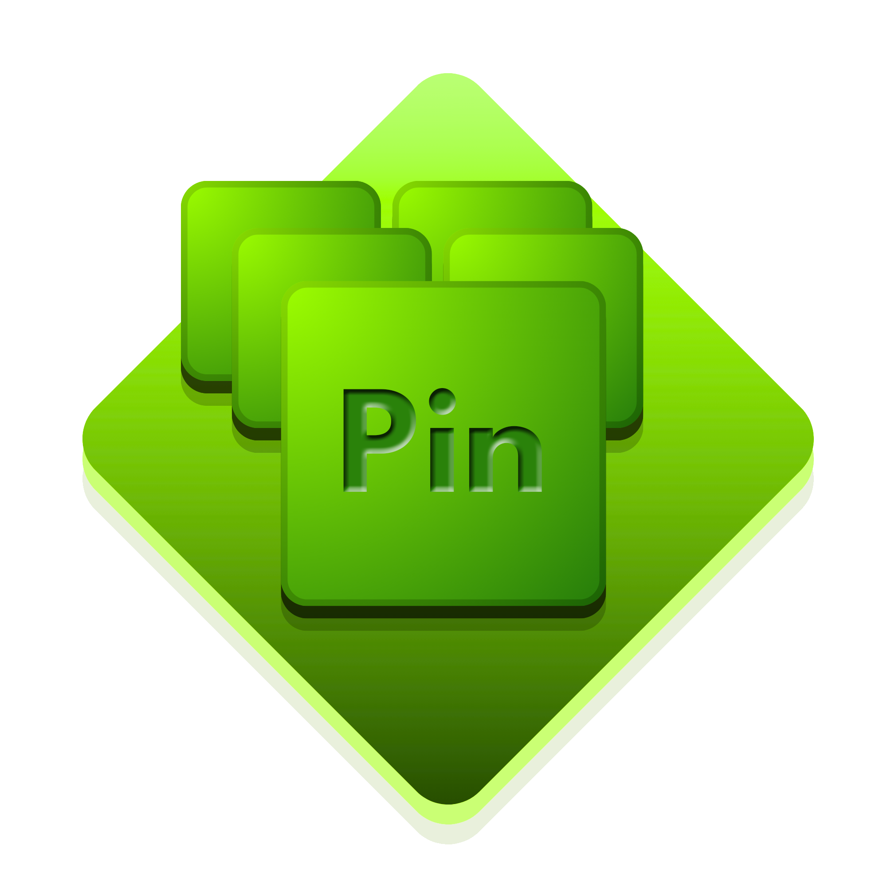

[Français](LISEZMOI.md)

# Iron Pins
Iron Pins was originally an exercise from a course for AI Development by Simplon.
Written in JavaScript, HTML5 and CSS, I'll use Tauri to make it as an app.
Iron Pins is a simple and intuitive task manager.
Its modern design is made to be simple and customizable.

# Features
## Task management
The user can create "Pins" with a chosen background color, with a status, a title and a description. These Pins are tasks.
They show up successively and are completely editable. The colored dot at top left is the current status of the task.
Blue: To do, Yellow: In progress, Green: Done et Red: Blocked.

## Tables
In Iron Pins, all the pins are stocked inside a table. Tables are made to separate user projects, avoiding to see task we don't wanted to see for the said project.

## Local Storage
By using JavaScript, Iron Pins stocks directly datas inside the JavaScript's local storage. This mean that at first, Pins doesn't need to be saved in a rotting file in your computer.

## Upcoming features
- Export and Importation a table from file.
- Show creation date
- Choose custom background color (for Pins)